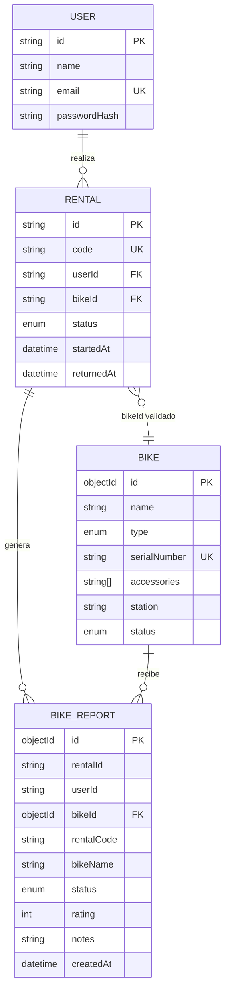

# ER híbrido

## Zonas

- **PostgreSQL:** `User` y `Rental`. Aquí se garantizan las transacciones y la relación 1:N.
- **MongoDB:** `Bike` y `BikeReport`. Aquí se garantizan validaciones del documento, el catálogo flexible, los índices y el historial.
- Las relaciones entre bases son conceptuales y se representan con líneas punteadas: `Rental.bikeId → Bike._id`, `BikeReport.rentalId → Rental.id` y `BikeReport.userId → User.id`.
